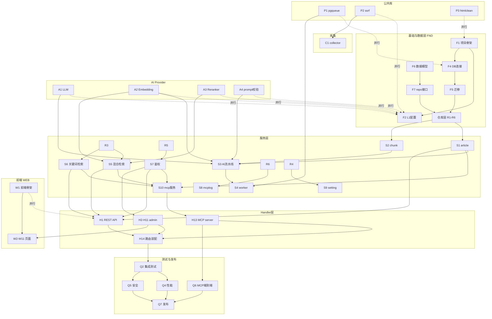

# AiKnow 开发计划（v1 MVP）

**版本**：v1.0  
**日期**：2026-09-07  
**依据**：[PRD.md](./PRD.md)（v3.4.1）  
**状态**：待执行

> 本文档是 PRD 第十一章「7 周路线图」的细化落地版本，将开发工作拆解为可执行、可追踪、可并行调度的工作项，并明确每个工作项的依赖关系、可并行度、交付物与验收标准映射。

---

## 目录

1. [计划概述](#1-计划概述)
2. [开发原则与约定](#2-开发原则与约定)
3. [并行开发轨道（Streams）](#3-并行开发轨道streams)
4. [任务分解总表（WBS）](#4-任务分解总表wbs)
5. [依赖关系与关键路径](#5-依赖关系与关键路径)
6. [阶段计划与里程碑](#6-阶段计划与里程碑)
7. [并行执行矩阵](#7-并行执行矩阵)
8. [团队配置建议](#8-团队配置建议)
9. [风险与缓冲](#9-风险与缓冲)
10. [附录 A：任务-验收标准映射](#10-附录-a任务-验收标准映射)

---

## 1. 计划概述

### 1.1 目标

在 **7 周（35 个工作日）** 内交付可部署的 AiKnow v1.0.0，覆盖 PRD 中的 P0 功能：

- 文章增删改查 + 手动/URL 采集（含防 SSRF）
- AI 异步处理（单次 LLM 调用产出摘要/分类/标签，状态可查、可重试）
- 混合检索（向量 + BM25 + RRF + Rerank）+ 关键词加权检索
- RESTful API + API Key 鉴权 + 速率限制
- MCP 四个工具（3 只读 + 1 写入，按 scope 过滤）+ MCP 请求日志
- Web 管理后台（10 个页面）
- 三层配置体系（L1 启动 / L2 业务热生效 / L3 凭据）

### 1.2 交付物清单

| 编号 | 交付物 | 对应任务 |
| :--- | :--- | :--- |
| D-1 | 可编译运行的服务骨架 + 完整数据库 Schema | F1–F7 |
| D-2 | 完整录入流程（手动 + URL），AI 处理状态可查 | C1, A1–A4, S1–S4 |
| D-3 | 混合检索 + 关键词检索接口可调用 | S5, S6, R3 |
| D-4 | 可管理文章的 Web 后台 | W1–W6, H2–H4 |
| D-5 | Claude Desktop 可挂载并读写的 MCP 服务 | H13, S10, H1 |
| D-6 | 完整后台调试与配置能力 | W7–W11, H5–H10 |
| D-7 | v1.0.0 可交付版本（含测试、文档） | Q1–Q6, D1–D3 |

### 1.3 范围界定

- **包含**：PRD 所有 P0 项
- **不含**：批量导入/导出、标签/分类管理界面、版本历史、回收站、MCP 更新/删除工具、多管理员/角色（均为 P1/P2 或 v2，见 PRD 1.3 与 2.x 优先级列）

---

## 2. 开发原则与约定

1. **接口先行（Contract First）**：`model` 层与 `repository`/`service` 接口在编码前冻结。接口是各轨道并行开发的「契约」，接口未定前不写实现。
2. **依赖注入**：所有 service/handler 通过构造器注入依赖，便于单元测试与 mock。
3. **Provider 抽象**：LLM / Embedding / Reranker 三处必须走接口抽象（见 PRD 3.3、9.3），实现与业务解耦。
4. **分层单向依赖**：`handler → service → repository → model`，禁止反向依赖与跨层直连。
5. **小步可验收**：每个任务完成时必须有可验证产物（可运行、可 curl、可 UI 操作），不允许「写完整个模块再联调」。
6. **数据库迁移只增不改**：迁移文件一旦合入主干即冻结，新变更用新迁移文件（PRD 八、AGENT.md 开发注意事项 1）。
7. **前端与后端通过 `/api/v1/*` 契约解耦**：PRD 第五章已定义完整接口，前端可基于契约并行开发，用 mock 数据先行。

---

## 3. 并行开发轨道（Streams）

> 本节回答「哪些部分可以并行开发」。整个开发按 **依赖独立性** 划分为 5 条并行轨道。同一轨道内任务串行，不同轨道之间在满足依赖后即可并行。

### 3.1 轨道划分

| 轨道 | 代号 | 内容 | 前置依赖 | 说明 |
| :--- | :--- | :--- | :--- | :--- |
| **基础与数据层** | `FND` | F1–F7, R1–R6, P1–P3 | 仅需项目骨架 | 所有其他轨道的底座，**必须最先启动** |
| **AI Provider 层** | `AIP` | A1–A4 | 无（仅需配置接口约定） | 与 FND 完全并行，只需等 F2 配置接口定型 |
| **采集与安全** | `COL` | C1 | F2（配置）、P2（SSRF） | P2 可极早启动，C1 依赖 P2 |
| **检索算法** | `SRC` | S5, S6, R3 | FND（R3）、AIP（A2/A3） | 可与 AI 处理流水线并行 |
| **前端** | `WEB` | W1–W11 | 无（契约先行）+ 后端 handler | 骨架 W1 零依赖，页面与后端 handler 并行 |

### 3.2 轨道依赖关系（Mermaid）



> 虚线 `-. 并行 .->` 表示「可提前并行启动，仅需接口约定」，不是严格的运行时依赖。

---

## 4. 任务分解总表（WBS）

> 任务 ID 前缀含义：`F`=基础、`P`=公共库、`A`=AI Provider、`C`=采集、`R`=仓库、`S`=服务、`H`=Handler、`W`=前端、`Q`=测试、`D`=文档。
>
> 「可并行」列标注该任务是否可与其它轨道并行推进；「工时」为单人估算（人天，中等水平工程师）。

### 4.1 基础与数据层（FND）

| ID | 任务 | 依赖 | 可并行 | 工时 | 交付物 |
| :--- | :--- | :--- | :---: | :---: | :--- |
| F1 | 项目骨架初始化（go.mod、Makefile、`.gitignore`、`.env.example`、`config.yaml.example`、`cmd/aiknow-server/main.go` 骨架、`hashpwd` 子命令） | — | ✅ | 1d | 可编译空服务 |
| F2 | L1 配置加载（`config.go`：env > .env > yaml > 默认值，godotenv，来源日志不打印值） | F1 | ✅ | 2d | 配置加载器 + 单测 |
| F3 | L2 配置缓存 + 热重载（`defaults.go`、`cache.go`、LISTEN/NOTIFY） | F1, F4 | ✅ | 2d | ConfigCache + 缺键回落默认值 |
| F4 | 数据库连接池（`postgres.go`，pgx pool，ping） | F1 | ✅ | 0.5d | DB 连接器 |
| F5 | 数据库迁移（migrations 001–005 + 迁移执行器） | F4 | ⚠️ 部分 | 2d | 完整 Schema + 索引 |
| F6 | 数据模型定义（`model/*.go`） | — | ✅ | 1d | 全部 struct + tag |
| F7 | repository/service 接口定义（含 mock 约定） | F6 | ✅ | 1d | 接口契约（冻结） |

### 4.2 公共库（pkg）

| ID | 任务 | 依赖 | 可并行 | 工时 | 交付物 |
| :--- | :--- | :--- | :---: | :---: | :--- |
| P1 | `pkg/pgqueue`：PGMQ 封装（send/pop/archive/DLQ/深度查询） | F4（仅联调） | ✅ | 1.5d | PGMQ 封装 + 单测 |
| P2 | `pkg/ssrf`：URL 校验、内网 IP 黑名单、DNS 重绑定、端口限制、重定向 | — | ✅ | 2d | SSRF 防护库 + 单测 |
| P3 | `pkg/htmlclean`：bluemonday 封装 | — | ✅ | 0.5d | XSS 清洗库 |

### 4.3 AI Provider 层（AIP）

| ID | 任务 | 依赖 | 可并行 | 工时 | 交付物 |
| :--- | :--- | :--- | :---: | :---: | :--- |
| A1 | `LLMProvider` 接口 + Qwen 实现（`llm.go`、`llm_qwen.go`，JSON mode，重试） | F2（接口约定） | ✅ | 2d | LLM 抽象 + Qwen 实现 |
| A2 | `EmbeddingProvider` 接口 + BAAI 实现（`embedding.go`、`embedding_baai.go`，批量） | F2 | ✅ | 1.5d | Embedding 抽象 + BAAI 实现 |
| A3 | `RerankerProvider` 接口 + BAAI 实现（`reranker.go`、`reranker_baai.go`） | F2 | ✅ | 1d | Reranker 抽象 + BAAI 实现 |
| A4 | 提示词渲染 + JSON 结果校验（`prompt.go`：template 渲染、schema 校验、分级重试策略） | — | ✅ | 1.5d | 提示词引擎 + 校验器 |

### 4.4 采集（COL）

| ID | 任务 | 依赖 | 可并行 | 工时 | 交付物 |
| :--- | :--- | :--- | :---: | :---: | :--- |
| C1 | `collector.go`：URL 采集、正文/标题/纯文本提取、内容 hash 去重、超时与重定向 | P2, F2 | ✅ | 2d | URL 采集器 |

### 4.5 仓库层（Repository）

| ID | 任务 | 依赖 | 可并行 | 工时 | 交付物 |
| :--- | :--- | :--- | :---: | :---: | :--- |
| R1 | `article_repo.go`：CRUD、分页筛选、去重查询、软删除、批量 | F5, F6, F7 | ✅ | 2d | 文章数据访问 |
| R2 | `chunk_repo.go`：chunk 增删查、按 article 分组 | F5, F6, F7 | ✅ | 1d | Chunk 数据访问 |
| R3 | `search_repo.go`：pgvector HNSW 查询 + pg_textsearch BM25 查询 | F5, F6, F7 | ✅ | 2d | 检索数据访问 |
| R4 | `setting_repo.go`：settings/setting_history 读写 | F5, F6, F7 | ✅ | 1d | 配置数据访问 |
| R5 | `apikey_repo.go`：api_keys 增删查（哈希） | F5, F6, F7 | ✅ | 0.5d | API Key 数据访问 |
| R6 | `mcplog_repo.go`：mcp_request_logs 写入/查询/清理 | F5, F6, F7 | ✅ | 1d | 日志数据访问 |

### 4.6 服务层（Service）

| ID | 任务 | 依赖 | 可并行 | 工时 | 交付物 |
| :--- | :--- | :--- | :---: | :---: | :--- |
| S1 | `article.go`：文章 CRUD、分类/标签自动创建、去重、软删除 | R1 | ✅ | 2d | 文章服务 |
| S2 | `chunk.go`：文本切分（200–500 字 + overlap） | F6 | ✅ | 1d | 切分器 + 单测 |
| S3 | AI 处理流水线（编排：LLM → chunk → embedding → 状态更新） | S1, S2, A1, A2, A4, R2 | ⚠️ | 2d | 端到端处理流程 |
| S4 | `worker.go`：PGMQ 消费、并发、重试、状态字段更新 | P1, S3 | ⚠️ | 2d | 异步消费者 |
| S5 | `search.go`：混合检索（向量召回 + BM25 召回 + RRF + Rerank + 上下文补全） | A2, A3, R3 | ✅ | 3d | 混合检索服务 |
| S6 | `search_keyword.go`：关键词加权检索（标签/分类/标题/摘要/正文 5 档） | R3 | ✅ | 2d | 关键词检索服务 |
| S7 | `auth.go`：API Key 校验（SHA-256）、管理员认证、限流、登录锁定 | R5 | ✅ | 2d | 鉴权服务 |
| S8 | `mcplog.go`：MCP 日志异步写入 + 查询 | R6, P1 | ✅ | 1.5d | 日志服务 |
| S9 | `setting.go`：L2 配置读写 + 校验 + history | R4 | ✅ | 1.5d | 配置服务 |
| S10 | MCP 工具服务：4 工具实现 + scope 过滤 + 协议封装 | S5, S6, S1, S7 | ⚠️ | 2d | MCP 业务逻辑 |

### 4.7 Handler 层

| ID | 任务 | 依赖 | 可并行 | 工时 | 交付物 |
| :--- | :--- | :--- | :---: | :---: | :--- |
| H1 | RESTful API（`article.go`、`search.go`、`middleware.go`：API Key 鉴权 + 限流） | S1, S5, S6, S7 | ✅ | 3d | `/api/v1/*` 接口 |
| H2 | 后台认证（`auth.go`：login/logout/session/me，失败锁定） | S7 | ✅ | 1.5d | 登录接口 |
| H3 | 后台仪表盘（`dashboard.go`：统计 + 队列 + 活动 + 健康） | S1, S4, S8 | ✅ | 1d | 仪表盘接口 |
| H4 | 后台文章（`article.go`：批量操作、Chunk 查看） | S1, S3 | ✅ | 1.5d | 文章管理接口 |
| H5 | 后台检索调试（`search_debug.go`：分阶段结果 + 关键词 debug） | S5, S6 | ✅ | 2d | 调试接口 |
| H6 | 后台 MCP 调试代理（`mcp_debug.go`：`mcp/invoke` 转发） | S10, H13 | ⚠️ | 2d | MCP 调试代理 |
| H7 | 后台配置（`setting.go`：读写/reset/history） | S9 | ✅ | 1.5d | 配置接口 |
| H8 | 后台提示词（`prompt.go`：试跑） | A4, S9 | ✅ | 1d | 提示词测试 |
| H9 | 后台 API Key（`apikey.go`：CRUD，明文仅一次） | R5 | ✅ | 1d | API Key 接口 |
| H10 | 后台 MCP 日志（`log.go`：分页/筛选/全文检索/trace_id） | S8 | ✅ | 1.5d | 日志查询接口 |
| H11 | 后台中间件（`middleware.go`：Session + CSRF） | S7 | ✅ | 1d | 鉴权中间件 |
| H12 | Web UI 路由（`web/handler.go`：embed 静态资源 + SPA 回退） | — | ✅ | 0.5d | 静态资源服务 |
| H13 | MCP 服务端（`mcp/server.go`：Streamable HTTP、initialize/tools/list/tools/call、scope 过滤、Origin 校验、trace_id、SSE） | S10, S7, S8 | ⚠️ | 3d | `/mcp` 端点 |
| H14 | 路由装配（`main.go`：注册全部路由 + 中间件链 + 启动 worker） | H1–H13 | ⚠️ | 1d | 可启动完整服务 |

### 4.8 前端（WEB）

| ID | 任务 | 依赖 | 可并行 | 工时 | 交付物 |
| :--- | :--- | :--- | :---: | :---: | :--- |
| W1 | 前端骨架（`index.html`、Tailwind 构建、`app.js` 路由、布局、登录态） | — | ✅ | 2d | 可导航页面壳 |
| W2 | 登录页（`login`） | W1, H2 | ✅ | 1d | 登录页 |
| W3 | 仪表盘页（`dashboard`） | W1, H3 | ✅ | 1.5d | 仪表盘页 |
| W4 | 文章列表页（`articles`） | W1, H1/H4 | ✅ | 2d | 列表页 |
| W5 | 文章编辑页（`articles/:id`） | W1, H4 | ✅ | 2d | 编辑页 |
| W6 | 文章录入页（`articles/new`） | W1, H4 | ✅ | 1.5d | 录入页 |
| W7 | 检索测试页（`search`） | W1, H5 | ✅ | 2d | 检索调试页 |
| W8 | MCP 调试页（`mcp-debug`） | W1, H6 | ✅ | 2d | MCP 调试页 |
| W9 | MCP 日志页（`mcp-logs`） | W1, H10 | ✅ | 1.5d | 日志页 |
| W10 | 系统配置页（`settings`） | W1, H7, H8 | ✅ | 1.5d | 配置页 |
| W11 | API Key 管理页（`settings/api-keys`） | W1, H9 | ✅ | 1d | API Key 页 |

### 4.9 测试与质量（Q）

| ID | 任务 | 依赖 | 可并行 | 工时 | 交付物 |
| :--- | :--- | :--- | :---: | :---: | :--- |
| Q1 | 单元测试（service/repo/pkg，随开发持续） | 各模块 | ✅ | 持续 | 单测覆盖 |
| Q2 | 集成测试（API 端到端） | H14 | ✅ | 3d | 集成测试套件 |
| Q3 | 检索评测集（标准问题集 + TopK 命中率/引用准确率脚本） | S5, S6 | ✅ | 2d | 评测集 + 脚本 |
| Q4 | 性能测试（压测 + P95 测量，见 PRD 9.1） | Q2 | ⚠️ | 2d | 性能报告 |
| Q5 | 安全测试（SSRF/XSS/鉴权/限流，见 PRD 6） | H14 | ✅ | 2d | 安全测试报告 |
| Q6 | MCP 端到端测试（Claude Desktop 挂载 + 4 工具） | H13 | ✅ | 2d | 挂载验证记录 |
| Q7 | 发布准备（Bug 修复、验收标准逐项核对、版本标记） | Q2–Q6 | ⚠️ | 2d | v1.0.0 标签 |

### 4.10 文档（D）

| ID | 任务 | 依赖 | 可并行 | 工时 | 交付物 |
| :--- | :--- | :--- | :---: | :---: | :--- |
| D1 | README + 部署文档 | H14 | ✅ | 1d | 部署说明 |
| D2 | 配置与 API 文档 | F2, H1 | ✅ | 1d | 接口文档 |
| D3 | MCP 使用文档（含 Claude Desktop 配置示例） | H13 | ✅ | 1d | MCP 接入说明 |

---

## 5. 依赖关系与关键路径

### 5.1 关键路径（Critical Path）

> 串行依赖最长的一条链，决定最短交付周期。任何关键路径任务延期，整体交付即延期。

```
F1(1) → F4(0.5) → F5(2) → R3(2) → S5(3) → S10(2) → H13(3) → H14(1) → Q2(3) → Q4/Q5(2) → Q7(2)
```

关键路径累计 **约 21.5 人天**，对应「检索核心 → MCP → 集成测试 → 发布」主线。其余任务大部分可并行消化，不在关键路径上。

> **解读**：检索与 MCP 是真正的瓶颈。优先保障 F5（迁移含向量/BM25 索引）、R3（检索仓库）、S5（混合检索）不被阻塞，是压缩总工期的关键。

### 5.2 三条并行支线（非关键路径）

| 支线 | 链 | 说明 |
| :--- | :--- | :--- |
| **AI 处理支线** | `A1→S3→S4` | 与检索支线完全并行，仅共享 FND |
| **采集支线** | `P2→C1→S3` | P2 零依赖，可最早启动 |
| **前端支线** | `W1→W2..W11` | 契约先行，W1 零依赖，页面随 handler 陆续并跑 |

### 5.3 依赖冲突点（需重点协调）

| 冲突点 | 涉及任务 | 协调策略 |
| :--- | :--- | :--- |
| `VECTOR(1024)` 维度与 Embedding 实现绑定 | F5 / A2 | 迁移与 Embedding 实现必须统一 `1024`，由 F6 模型 + A2 契约冻结锁定 |
| MCP 调试代理依赖 MCP 服务端 | H6 / H13 | H6 可先以接口桩开发，H13 就绪后联调 |
| 前端页面依赖后端接口 | W* / H* | PRD 第五章接口已冻结，前端用 mock 先行，后端就绪后切换真实接口 |
| Worker 并发与 PGMQ 封装 | S4 / P1 | P1 先出接口，S4 用桩开发 |

---

## 6. 阶段计划与里程碑

> 以下映射 PRD 第十一章 7 周路线图，但按并行轨道重新组织，明确「每周谁做什么、可并行什么」。

### Phase 1：基础框架（Week 1）

**目标**：可编译骨架 + Schema 就绪 + 配置可读写 + 三处 AI Provider 接口可用

| 轨道 | 本周任务 |
| :--- | :--- |
| FND | F1–F7, R1–R6（仓库层可顺延至 W2 完成） |
| 公共库 | P1, P2, P3 |
| AIP | A1, A2, A3, A4 |
| WEB | W1（前端骨架 + 登录态 + 布局） |

**里程碑 M1**：`go build` 通过；`migrations` 执行成功；L1 配置三种来源加载正确；AI Provider 三接口可调用（mock 模式）；前端页面壳可导航。

### Phase 2：采集 + AI 处理（Week 2）

**目标**：完整录入流程（手动 + URL），异步处理状态可查询

| 轨道 | 本周任务 |
| :--- | :--- |
| FND | R1–R6 收尾 |
| COL | C1（采集器） |
| 服务 | S1, S2, S3, S4（AI 流水线 + Worker） |

**里程碑 M2**：`POST /api/v1/articles`（手动 + URL）可录入；文章状态从 `pending → processing → completed`；摘要/分类/标签写入；`get status` 可查询；重试/失败状态正确。

### Phase 3：检索核心（Week 3）

**目标**：混合检索 + 关键词检索接口可调用

| 轨道 | 本周任务 |
| :--- | :--- |
| 检索 | S5（混合检索）、S6（关键词检索） |
| 仓库 | R3 联调（HNSW + BM25） |
| 服务 | S7（鉴权）、S9（配置） |
| Handler | H1（REST API）启动 |

**里程碑 M3**：`POST /api/v1/search` 返回精排 Top 5；`POST /api/v1/search/keywords` 返回加权文章卡片；中文 Query 分词正确；向量 + BM25 召回 + RRF 融合各阶段可调试。

### Phase 4：精排 + 后台基础页（Week 4）

**目标**：可管理文章的 Web 后台

| 轨道 | 本周任务 |
| :--- | :--- |
| Handler | H2（登录）、H3（仪表盘）、H4（文章管理）、H11（admin 中间件）、H12（web 路由） |
| 服务 | S7 收尾（登录锁定）、S8（mcplog）启动 |
| 前端 | W2（登录）、W3（仪表盘）、W4（列表）、W5（编辑）、W6（录入） |

**里程碑 M4**：后台可登录（失败锁定生效）；仪表盘展示统计；文章列表筛选/批量操作；文章编辑可改正文（重置 pending）与 AI 结果（不重置）；Chunk 可预览。

### Phase 5：MCP + API（Week 5）

**目标**：Claude Desktop 可正常挂载并读写

| 轨道 | 本周任务 |
| :--- | :--- |
| 服务 | S10（MCP 工具）、S8 收尾 |
| Handler | H13（MCP 服务端）、H1 收尾（限流）、H14（路由装配，可提前） |
| 前端 | 无（本周聚焦后端） |

**里程碑 M5**：`/mcp` 握手成功；`tools/list` 按 scope 过滤；4 工具可调用；`add_article_by_url` 校验 readwrite scope；401/403/限流/SSRF 拦截均生效；MCP 日志落库。

### Phase 6：调试与配置页（Week 6）

**目标**：完整后台管理与调试能力

| 轨道 | 本周任务 |
| :--- | :--- |
| Handler | H5（检索调试）、H6（MCP 调试代理）、H7（配置）、H8（提示词）、H9（API Key）、H10（日志） |
| 前端 | W7（检索测试）、W8（MCP 调试）、W9（日志）、W10（配置）、W11（API Key） |

**里程碑 M6**：检索测试页展示四阶段结果 + 耗时 + 分词；MCP 调试页可发 initialize/tools/list/tools/call + SSE；配置热生效；API Key 仅存哈希。

### Phase 7：测试与发布（Week 7）

**目标**：v1.0.0 可交付

| 轨道 | 本周任务 |
| :--- | :--- |
| 测试 | Q2（集成）、Q3（检索评测）、Q4（性能）、Q5（安全）、Q6（MCP 端到端） |
| 文档 | D1, D2, D3 |
| 收尾 | Q7（Bug 修复 + 验收标准逐项核对 + 版本标记） |

**里程碑 M7（终验）**：PRD 第十章全部验收标准通过；v1.0.0 打 tag。

---

## 7. 并行执行矩阵

> 一张图看清「任意时刻哪些任务在同时进行」。行 = 周，列 = 轨道；✅ 表示该周此轨道有活跃任务。

| 周 | FND 基础/数据 | 公共库 pkg | AI Provider | 采集 | 服务层 | Handler | 前端 | 测试/文档 |
| :---: | :---: | :---: | :---: | :---: | :---: | :---: | :---: | :---: |
| **W1** | ✅ | ✅ | ✅ | — | — | — | ✅(骨架) | — |
| **W2** | ✅(收尾) | — | — | ✅ | ✅ | — | — | — |
| **W3** | ✅(R3) | — | — | — | ✅ | ✅ | — | — |
| **W4** | — | — | — | — | ✅ | ✅ | ✅ | — |
| **W5** | — | — | — | — | ✅ | ✅ | — | — |
| **W6** | — | — | — | — | — | ✅ | ✅ | — |
| **W7** | — | — | — | — | — | — | — | ✅ |

### 7.1 可并行清单（汇总）

以下任务组**相互之间无依赖，可并行开发**，仅需满足「接口已冻结」这一前提：

1. **AI Provider 三实现 + 提示词校验**（A1/A2/A3/A4）—— 彼此独立，且与数据层完全解耦。
2. **公共库三个包**（P1/P2/P3）—— 彼此独立，P2/P3 零依赖，P1 仅联调时需 DB。
3. **采集器**（C1）与 **AI Provider** 并行 —— C1 只依赖 P2（SSRF）。
4. **六个仓库实现**（R1–R6）—— Schema 就绪后彼此独立，可由多人同时实现。
5. **混合检索**（S5）与 **AI 处理流水线**（S3）并行 —— 二者分属不同服务，无交叉依赖。
6. **关键词检索**（S6）与 **混合检索**（S5）并行 —— 共享 R3 但逻辑独立。
7. **鉴权**（S7）、**配置**（S9）、**日志**（S8）—— 三个服务彼此独立，可同时开工。
8. **前端骨架**（W1）与所有后端轨道并行 —— 零依赖，最早启动。
9. **11 个前端页面**（W2–W11）—— 基于冻结的 API 契约，用 mock 先行，与后端 handler 并行，后端就绪后切换。
10. **集成测试**（Q2）、**安全测试**（Q5）、**检索评测**（Q3）—— 三者独立，可并行开展。

### 7.2 不可并行的串行链（必须顺序执行）

1. `F1 → F4 → F5`（骨架 → 连接 → 迁移）
2. `F5 → R*`（迁移 → 仓库）
3. `R* → S*`（仓库 → 服务）
4. `S* → H*`（服务 → Handler）
5. `S10 → H13 → H14`（MCP 服务 → MCP 端点 → 路由）
6. `Q2 → Q4/Q5 → Q7`（集成测试 → 性能/安全 → 发布）

---

## 8. 团队配置建议

### 8.1 推荐配置（4 后端 + 1 前端 + 1 测试）

| 角色 | 人数 | 负责轨道 | 主要任务 |
| :--- | :---: | :--- | :--- |
| 后端 A（架构/核心） | 1 | FND + 关键路径 | F1–F7, R3, S5, 把关接口契约与迁移 |
| 后端 B（AI 处理） | 1 | AIP + 采集 + AI 流水线 | A1–A4, P2, C1, S1–S4 |
| 后端 C（接口/鉴权） | 1 | Handler + 鉴权 | S7, S8, S9, H1–H14, MCP |
| 后端 D（检索/关键词） | 1 | 检索算法 | R1, R2, S5 协助, S6, H5 |
| 前端 | 1 | WEB | W1–W11 |
| 测试（可兼/外援） | 1 | Q | Q2–Q6, 验收标准核对 |

> 若人力只有 **3 人**（2 后端 + 1 前端），则将「AI 处理」与「接口/鉴权」合并给同一个人，检索支线由另一人承担；前端兼测试。总工期可能顺延 3–5 天，需砍掉部分非关键 P0 调试项的打磨时间。

### 8.2 协作机制

- **每日站会**：对齐跨轨道接口阻塞（尤其 F5 迁移 / R3 / S5 关键路径）。
- **契约变更走评审**：`model`/`repository`/`service` 接口一旦冻结，变更需评审并通知所有轨道。
- **主干开发 + 特性分支**：每个任务一个分支，`F7` 接口契约合入主干后各轨道 rebase。
- **CI 门槛**：PR 合并需通过 `go test` + `go vet` + 迁移幂等检查。

---

## 9. 风险与缓冲

> 在 PRD 第十二章风险基础上，补充「开发计划层面」的执行风险与应对。

| 风险 | 影响 | 概率 | 应对 / 缓冲 |
| :--- | :--- | :---: | :--- |
| **关键路径任务阻塞**（F5 迁移 / R3 / S5） | 整体延期 | 中 | 后端 A 专责关键路径，任何阻塞当日升级；迁移 SQL 可由 D 并行起草 |
| **pg_textsearch / zhparser 环境不可用**（PRD 风险 2） | 检索支线停工 | 中 | W1 内完成环境验证（PoC），失败立即切 ParadeDB `pg_bm25` 或 `pg_jieba` 预案 |
| **AI Provider 接口联调滞后**（BAAI/Qwen 限流或签名问题） | 流水线/检索延迟 | 中 | AIP 轨道以 mock 先行，真实联调不阻塞下游；Provider 抽象层预留切换（PRD 9.3） |
| **前端与后端契约漂移** | 联调返工 | 中 | PRD 第五章接口为准，前端 mock 数据结构严格对齐；后端 H* 合入时做契约测试 |
| **人力不足（3 人）** | 工期顺延 | 中 | 见 8.1 降配方案；优先砍「非关键调试项打磨」而非核心功能 |
| **验收标准遗漏** | 发布返工 | 低 | Q7 阶段逐项对照 PRD 第十章打勾，附录 A 提供映射表 |
| **AI 处理延迟导致 PGMQ 积压**（PRD 风险 5） | 状态 pending 堆积 | 中 | Worker 并发可调（`worker.concurrency` L1），监控队列深度，Dashboard 暴露队列状态 |

**缓冲策略**：7 周计划中，Phase 3（检索）与 Phase 5（MCP）在 PRD 中标注「相对宽松」，预留约 3 天缓冲。若关键路径延期，优先降级 `match_mode=all`、`matched` 字段为 P1（PRD 十一 v3.4 工期提示），而非砍整段功能。

---

## 10. 附录 A：任务-验收标准映射

> 每个任务完成后，对照 PRD 第十章验收标准自测，Q7 阶段逐项复核。

| 任务 | 对应验收标准（PRD 10.x） |
| :--- | :--- |
| C1（采集） | 10.1 URL 采集验收（全部 4 项） |
| P2（SSRF） | 10.1（内网拦截）、10.6（SSRF 拦截/不回显/协议拒绝）、10.7（SSRF 黑白名单） |
| A1/A4 + S3/S4（AI 处理） | 10.2 AI 处理验收（全部 9 项） |
| S5（混合检索） | 10.3 检索验收（全部 5 项） |
| S6（关键词检索） | 10.5 关键词检索验收（全部 12 项） |
| H13/S10（MCP） | 10.4 MCP 验收（全部 11 项）、10.6 MCP 写入工具验收（全部 9 项） |
| S7/H11（鉴权/限流） | 10.7 安全验收（API Key/限流/401 等） |
| P3（XSS 清洗） | 10.7 安全验收（XSS/CSP） |
| S8/H10（MCP 日志） | 10.10 MCP 请求日志验收（全部 11 项） |
| W2/H2（登录） | 10.8（登录锁定）、10.7（明文密码不落日志） |
| W3/H3（仪表盘） | 10.8（仪表盘统计） |
| W4/W5/W6/H4（文章管理） | 10.8 后台页面验收（列表/编辑/录入相关项） |
| W7/H5（检索测试） | 10.8（检索测试页）、10.5（权重调试排序变化） |
| W8/H6（MCP 调试） | 10.9 MCP 调试页面验收（全部 11 项） |
| W9/H10（MCP 日志页） | 10.10（重放/全文检索/trace_id） |
| W10/H7/H8（配置/提示词） | 10.11 系统配置验收（全部 10 项） |
| W11/H9（API Key） | 10.7（仅存哈希）、10.11（敏感信息不出现在配置页） |
| F2/F3（配置加载） | 10.12 配置加载验收（全部 7 项） |

---

## 附录 B：任务 ID 速查表

| 层 | ID 范围 | 任务 |
| :--- | :--- | :--- |
| 基础 | F1–F7 | 骨架 / L1 配置 / L2 缓存 / DB / 迁移 / 模型 / 接口 |
| 公共库 | P1–P3 | pgqueue / ssrf / htmlclean |
| AI Provider | A1–A4 | LLM / Embedding / Reranker / 提示词校验 |
| 采集 | C1 | 网页采集 |
| 仓库 | R1–R6 | article / chunk / search / setting / apikey / mcplog |
| 服务 | S1–S10 | article / chunk / AI 流水线 / worker / 混合检索 / 关键词 / 鉴权 / mcplog / setting / MCP |
| Handler | H1–H14 | REST / admin(2–11) / web / MCP / 路由 |
| 前端 | W1–W11 | 骨架 / 登录 / 仪表盘 / 列表 / 编辑 / 录入 / 检索 / MCP 调试 / 日志 / 配置 / API Key |
| 测试 | Q1–Q7 | 单测 / 集成 / 评测 / 性能 / 安全 / MCP 端到端 / 发布 |
| 文档 | D1–D3 | README / API / MCP |
